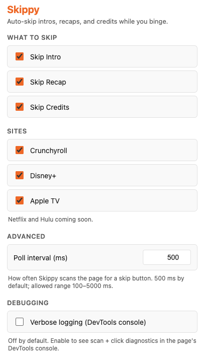

# Skippy-FF

[](https://github.com/synle/skippy-ff/actions/workflows/build-main.yml)

Auto-skip intros, recaps, and credits while you binge. SponsorBlock for streaming services.

Currently supports **Crunchyroll**, **Disney+** (including **Hulu** content played through Disney+), **Apple TV**, **Netflix**, **Prime Video**, **Max** (HBO Max), **Paramount+**, **Peacock**, **Tubi**, **AMC+**, and **Shudder**.

## How it works

Content scripts find skip buttons through site-specific selectors and click them automatically. A per-button cooldown prevents repeated clicks while the player advances. Polling pauses in hidden tabs and resumes when visible.

Control skip types in the popup, options page, or right-click `Skippy <Site> Settings` menu. **Search Movie Information** opens searches through enabled providers. It uses selected text or the final URL path segment, not the page title; select title text when the URL contains an opaque ID.

## Install (unpacked, for development)

```bash
npm ci --ignore-scripts
npm run build
```

1. Open Chrome → `chrome://extensions/`
2. Enable **Developer mode**
3. **Load unpacked** → select the `dist/` folder
4. Pin the extension to your toolbar (puzzle icon → pin Skippy-FF) for quick access to settings

## Scripts

| Command                | Purpose                                                  |
| ---------------------- | -------------------------------------------------------- |
| `npm run build`        | Emit storage declarations and build `dist/` with Vite    |
| `npm run bundle`       | Zip `dist/` into `skippy-ff.zip`                         |
| `npm run package`      | Build + bundle                                           |
| `npm run format`       | Format files with oxfmt (writes changes)                 |
| `npm run format:check` | Check formatting without writing                         |
| `npm run validate`     | Tests, lint, build, then format; required before commits |

## Project structure

```
skippy-ff/
├── src/
│   ├── manifest.json                  # MV3 manifest
│   ├── background.js                  # Background SW — registers right-click context menu
│   ├── helpers/
│   │   ├── storage.js                 # Settings, site registry, search providers
│   │   ├── menu.js                    # Pure menu and title-search helpers
│   │   └── diagnostics.js             # Bounded local evidence + worker persistence
│   ├── content/
│   │   ├── skippy-core.js             # visibility + click helpers, polling loop
│   │   ├── skippy-crunchyroll.js      # Crunchyroll site adapter
│   │   ├── skippy-disneyplus.js       # Disney+ site adapter
│   │   ├── skippy-appletv.js          # Apple TV site adapter
│   │   ├── skippy-netflix.js          # Netflix site adapter
│   │   ├── skippy-primevideo.js       # Amazon Prime Video site adapter
│   │   ├── skippy-max.js              # Max (HBO Max) site adapter
│   │   ├── skippy-paramountplus.js    # Paramount+ site adapter
│   │   ├── skippy-peacock.js          # Peacock site adapter
│   │   ├── skippy-tubi.js             # Tubi site adapter
│   │   └── skippy-amcplus.js          # AMC+ / Shudder site adapter (shared JW Player stack)
│   └── pages/options/                 # Settings page (also used as popup)
│       ├── options.html
│       ├── options.css
│       ├── options.js
│       └── diagnostics.js             # Export/clear controls
├── public/                            # Extension icons
├── scripts/bundle.js                  # Zip dist/ for store upload
├── tests/                             # Vitest + jsdom regression suites
├── vite.config.js                     # Build plugins and coverage configuration
├── AGENTS.md                          # Repository rules for coding agents
├── DEV.md                             # Development and debugging workflows
├── ARCHITECTURE.md                    # Runtime and build map
├── package.json
└── README.md
```

## Settings

<p align="center">
  
</p>

The popup and options page share **Master Settings**, **Sites**, **Search Movie Information**, **Advanced**, and **Debugging** sections. Open options through `chrome://extensions/` → Skippy → Details → Extension options.

Each site card has an **Enable** toggle, a **Follow master settings** toggle, and (when not following master) its own copy of the four skip flags. Disabling a site short-circuits every flag for that site. Enabled + following master → the master flags apply. Enabled + not following master → the site's own flags apply.

### Defaults

| Flag              | Default                                               | Description                                                                                                                                                                                                |
| ----------------- | ----------------------------------------------------- | ---------------------------------------------------------------------------------------------------------------------------------------------------------------------------------------------------------- |
| `skipIntro`       | `true`                                                | Click "Skip Intro" when shown                                                                                                                                                                              |
| `skipRecap`       | `true`                                                | Click "Skip Recap" when shown                                                                                                                                                                              |
| `skipCredits`     | `true`                                                | Click "Skip Credits" when shown                                                                                                                                                                            |
| `nextEpisode`     | `true`                                                | Auto-start the next episode (post-credits "Next Episode" / "Play Next Episode" button)                                                                                                                     |
| `verboseLogging`  | `false`                                               | Emit `[Skippy]` / `[Skippy/<site>]` diagnostics to DevTools                                                                                                                                                |
| `pollIntervalMs`  | `500`                                                 | Page-scan cadence; clamped to 100–5000 ms                                                                                                                                                                  |
| `enabledSites`    | all on                                                | Per-site enable toggle (`crunchyroll.com`, `disneyplus.com`, `tv.apple.com`, `netflix.com`, `primevideo.com`, `max.com`, `paramountplus.com`, `peacocktv.com`, `tubitv.com`, `amcplus.com`, `shudder.com`) |
| `siteOverrides`   | `{}`                                                  | Optional per-site override: `{ [host]: { useOverride, skipIntro, skipRecap, skipCredits, nextEpisode } }`. `useOverride=true` makes that site use its own flags instead of the master ones                 |
| `searchProviders` | `{ rottentomatoes: true, imdb: false, google: true }` | Enable title-search providers; displayed in Rotten Tomatoes, IMDb, Google order                                                                                                                            |

Settings are stored in `chrome.storage.sync` and roam across signed-in Chrome profiles when browser sync is enabled. Diagnostic evidence stays in `chrome.storage.local` and does not sync.

## Crash diagnostics

Open **Debugging → Export diagnostics JSON** in Skippy settings to copy a bounded local report. It includes sanitized Skippy error evidence and your browser user agent. Review before sharing; nothing is uploaded automatically. **Clear local diagnostics** removes the report trail without changing settings.

Native Brave/Chrome crashes cannot be attributed from extension logs alone. For Windows Brave crashes, collect the matching uploaded report ID from `brave://crashes` and follow `DEV.md` → **Persistent diagnostics and Brave/Windows crash triage**. Normal extension worker sleep is not a crash.

## Documentation

- `ARCHITECTURE.md` — system map (components, data flow, build pipeline, CI/CD).
- `DEV.md` — local development workflow, adding a new site, debugging guide.
- `AGENTS.md` — project rules for coding agents.
